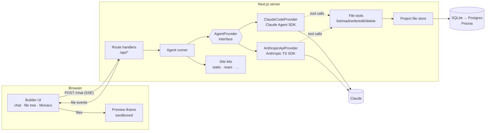

# Architecture

> Companion to [projectDetails.md](../projectDetails.md). This describes the design we intend to build; SDK call names are confirmed against the current SDK docs during implementation.

## 1. System overview



**Key idea:** Claude never touches the server's real disk. It works on a **virtual project** (rows in the database) through a small set of file tools that we control and validate. Both providers drive the **same tools**, so they behave the same way.

## 2. Tech stack

| Layer | Choice |
|---|---|
| Framework | Next.js (App Router, route handlers, server actions where convenient), TypeScript strict mode |
| UI | Tailwind CSS, shadcn/ui, lucide icons, `react-resizable-panels` for the split layout |
| Code editor | `@monaco-editor/react` |
| Preview: Static kit | Server route that serves project files from the database into a sandboxed iframe |
| Preview: React kit (and future Vue/Svelte) | Sandpack (`@codesandbox/sandpack-react`), an in-browser bundler |
| AI (testing) | `@anthropic-ai/claude-agent-sdk`, using the developer's local Claude Code login |
| AI (production) | `@anthropic-ai/sdk`, with `ANTHROPIC_API_KEY` |
| Validation | `zod` (tool input schemas, API bodies) |
| DB / ORM | Prisma; SQLite (`file:./dev.db`) for development, Postgres later |
| Auth | Auth.js (NextAuth v5) Credentials provider, `bcryptjs`, JWT session |
| Export | `jszip` |

## 3. Provider layer (the "provider switch")

```ts
// src/server/ai/types.ts (sketch)
export type AgentEvent =
  | { type: "text_delta"; text: string }
  | { type: "thinking_delta"; text: string }          // summarized thinking, optional
  | { type: "tool_start"; tool: string; input: unknown }
  | { type: "file_changed"; path: string; op: "write" | "edit" | "delete" }
  | { type: "tool_error"; tool: string; message: string }
  | { type: "usage"; inputTokens: number; outputTokens: number }
  | { type: "done"; summary: string }
  | { type: "error"; message: string };

export interface AgentProvider {
  readonly id: "claude-code" | "anthropic-api";
  run(req: {
    system: string;              // base prompt + kit rules + project file index
    history: ChatTurn[];         // earlier chat turns of this project
    userMessage: string;
    tools: ProjectTools;         // bound to one project's file store
    signal: AbortSignal;         // the user pressed "Stop"
  }): AsyncIterable<AgentEvent>;
}
```

`getProvider()` reads `AI_PROVIDER` from the environment and returns the right implementation.

### 3a. `ClaudeCodeProvider` (local testing)
- Uses the Claude Agent SDK's `query()`. It authenticates with the developer's **local Claude Code login**, so no API key is needed.
- Our file tools are registered as an **in-process MCP server**. Every built-in tool (Bash, Read, Write, Edit, WebFetch, …) is **disabled**, so the agent can only touch the virtual project.
- Works for the **local / internal testing only.** A Claude Code subscription login must not serve the product's end users; production uses 3b.

### 3b. `AnthropicApiProvider` (production)
- Uses `client.messages.stream(...)` with our tools as custom tools, in a manual agent loop (a loop that runs until `stop_reason` is no longer `tool_use`). We write the loop ourselves because we need fine control over streaming events and cancellation.
- Request settings: model `claude-opus-5-5`, adaptive thinking (`display: "summarized"` so the UI can show a "thinking…" summary), `output_config.effort` from env (default `medium`), `max_tokens` around 64k (streaming).
- Each tool sets `eager_input_streaming: true`, so a big `write_file` input streams in as it's generated. Tool inputs are validated with zod before they run.
- **Prompt caching** covers the system prompt, the kit rules and the tool definitions (all stable). Volatile content (the file index, the user message) goes after the cache breakpoint.
- **Refusal fallback:** `fallbacks: "default"` (beta `server-side-fallback-2026-07-01`). If Claude declines a request, the API retries it on a fallback model inside the same call. The code checks `stop_reason` before reading content.
- Typed SDK errors are mapped to friendly UI messages: 429 means "busy, retry", 401 means "check API key".
- Notes for this model: no assistant prefill, no forced `tool_choice` (use `auto` plus prompt instructions), thinking can't be disabled.

## 4. Agent tools

These tools are defined once, in `src/server/ai/tools.ts`, with zod schemas, and adapted to each provider.

| Tool | Input | Behaviour |
|---|---|---|
| `list_files` | none | Returns paths and sizes in the project |
| `read_file` | `path` | Returns the file's content (truncated over a size cap, which the tool says when it happens) |
| `write_file` | `path`, `content` | Creates or overwrites a file |
| `edit_file` | `path`, `old_string`, `new_string` | Exact single replacement; returns an error if the text isn't found or matches more than once |
| `delete_file` | `path` | Removes a file |

**Guards:**
- Paths are normalised and must stay inside the project; `..` and absolute paths are rejected.
- Only text file types the kit allows are accepted.
- Size limits: about 200 KB per file, about 2 MB and 200 files per project.
- Each turn is capped at a maximum number of tool calls.

All writes in one AI turn are **buffered** and committed together when the turn ends, creating **one version**. If the user cancels mid-turn, the files written so far are kept and labelled "partial".

## 5. Site kits

```ts
// src/kits/types.ts (sketch)
export interface SiteKit {
  id: "static" | "react-vite";       // later: "vue-vite", "svelte-vite", …
  label: string;
  starterFiles: Record<string, string>;
  systemPrompt: string;              // framework rules, file layout, design guidance
  allowedExtensions: string[];
  preview: "static-server" | { sandpackTemplate: string };
  exportReadme: string;              // run instructions in the ZIP
}
```

| Kit | Generated layout | Preview | Exported project runs with |
|---|---|---|---|
| `static` | `index.html`, `*.html`, `css/`, `js/`, Tailwind via CDN | `/preview/[projectId]/[...path]` in an iframe | Open `index.html` |
| `react-vite` | `package.json`, `index.html`, `src/main.tsx`, `src/App.tsx`, `src/components/*` | Sandpack (`react-ts` / Vite template) | `npm install && npm run dev` |

**Templates** are file sets stored under `templates/<kit>/<slug>/` in the repo, with a `template.json` for the name, description and thumbnail. Creating a project from a template copies the template's files in as version 1.

## 6. Preview & security

- The preview iframe uses `sandbox="allow-scripts allow-forms"` and **never** `allow-same-origin`. Generated code can't read the builder's cookies or call its API.
- Static preview responses carry a strict CSP plus `X-Frame-Options` set for our origin. Production should serve previews from a **separate subdomain** (e.g. `preview.<domain>`).
- The preview reloads after file changes, debounced to about 300 ms; while the AI streams, it reloads when each file write is committed.
- Generated content is **data, not instructions**. File contents passed back to Claude are framed that way in the system prompt.

## 7. Data model (Prisma, sketch)

```prisma
model User {
  id           String    @id @default(cuid())
  email        String    @unique
  name         String?
  passwordHash String
  createdAt    DateTime  @default(now())
  projects     Project[]
}

model Project {
  id               String        @id @default(cuid())
  userId           String
  user             User          @relation(fields: [userId], references: [id], onDelete: Cascade)
  name             String
  kit              String        // "static" | "react-vite" | …
  templateSlug     String?
  currentVersionId String?
  createdAt        DateTime      @default(now())
  updatedAt        DateTime      @updatedAt
  files            ProjectFile[]
  versions         Version[]
  messages         ChatMessage[]
}

model ProjectFile {               // working copy
  id        String   @id @default(cuid())
  projectId String
  project   Project  @relation(fields: [projectId], references: [id], onDelete: Cascade)
  path      String
  content   String
  updatedAt DateTime @updatedAt
  @@unique([projectId, path])
}

model Version {                   // full snapshot; sites are small
  id        String   @id @default(cuid())
  projectId String
  project   Project  @relation(fields: [projectId], references: [id], onDelete: Cascade)
  number    Int
  source    String   // "ai" | "manual" | "template" | "restore"
  summary   String
  snapshot  String   // JSON: { [path]: content }
  createdAt DateTime @default(now())
  @@unique([projectId, number])
}

model ChatMessage {
  id        String   @id @default(cuid())
  projectId String
  project   Project  @relation(fields: [projectId], references: [id], onDelete: Cascade)
  role      String   // "user" | "assistant"
  content   String   // display text
  raw       String?  // provider-native blocks (JSON) so multi-turn context survives
  versionId String?
  createdAt DateTime @default(now())
}
```

Later optimisation: content-addressed file blobs to remove duplicate content across snapshots.

## 8. HTTP API

| Method & path | Purpose |
|---|---|
| `POST /api/auth/register` | Create an account (email, password ≥ 8 chars) |
| `/api/auth/[...nextauth]` | Auth.js sign-in / sign-out / session |
| `GET /api/projects` · `POST /api/projects` | List / create (`{ name, kit, templateSlug? }`) |
| `GET · PATCH · DELETE /api/projects/:id` | Read / rename / delete |
| `GET /api/projects/:id/files` · `PUT /api/projects/:id/files` | Get the file map / save manual edits (creates a version) |
| `POST /api/projects/:id/chat` | Run one agent turn; the response is a **Server-Sent Events** stream of `AgentEvent` |
| `POST /api/projects/:id/chat/stop` | Cancel the running turn |
| `GET /api/projects/:id/versions` · `POST /api/projects/:id/versions/:vid/restore` | History / restore |
| `GET /api/projects/:id/export` | ZIP download |
| `GET /api/templates?kit=` | Template catalogue |
| `GET /preview/:id/[...path]` | Static kit preview file server (owner-only) |

Every `/api/projects/*` route checks that the session user owns the project.

## 9. Folder structure

```
agentwebbuilder/
├─ docs/                      # this documentation
├─ prisma/schema.prisma
├─ templates/<kit>/<slug>/    # starter templates
├─ src/
│  ├─ app/
│  │  ├─ (auth)/login, register
│  │  ├─ dashboard/           # project list, "new project" dialog
│  │  ├─ project/[id]/        # builder: chat | preview | code
│  │  ├─ preview/[id]/[...path]/route.ts
│  │  └─ api/…                # route handlers (section 8)
│  ├─ components/             # chat, file-tree, editor, preview, version-panel
│  ├─ kits/                   # static.ts, react-vite.ts, index.ts (registry)
│  ├─ server/
│  │  ├─ ai/                  # types.ts, tools.ts, prompt.ts, runner.ts,
│  │  │                       # providers/claude-code.ts, providers/anthropic-api.ts
│  │  ├─ projects/            # file store, versions, export
│  │  ├─ auth.ts
│  │  └─ db.ts
│  └─ lib/                    # shared utils, SSE helpers
├─ .env.example
└─ projectDetails.md
```

## 10. Configuration (`.env`)

| Variable | Example | Notes |
|---|---|---|
| `AI_PROVIDER` | `claude-code` | `claude-code` (local test) or `anthropic-api` |
| `AI_MODEL` | `claude-opus-5-5` | Overrides the default model |
| `AI_EFFORT` | `medium` | `low`, `medium`, `high`, `xhigh` or `max` |
| `ANTHROPIC_API_KEY` | `sk-ant-…` | Required only for `anthropic-api` |
| `DATABASE_URL` | `file:./dev.db` | Postgres URL in production |
| `AUTH_SECRET` | random 32 bytes | Signs the Auth.js JWT |

## 11. Risks & mitigations

| Risk | Mitigation |
|---|---|
| Generated JS attacks the builder | Sandboxed iframe without same-origin, separate preview origin in production, CSP |
| Runaway agent loops or cost | Caps on tool calls and output tokens per turn, a stop button, usage shown per turn, per-user rate limit |
| Claude Code login used in production | `claude-code` provider refuses to start when `NODE_ENV=production` |
| Large projects overflow context | Send a file index (paths + sizes) instead of every file; Claude calls `read_file` for what it needs |
| Sandpack needs CodeSandbox's hosted bundler | Acceptable for the MVP; self-hosting or WebContainers can be evaluated in phase 2 |
